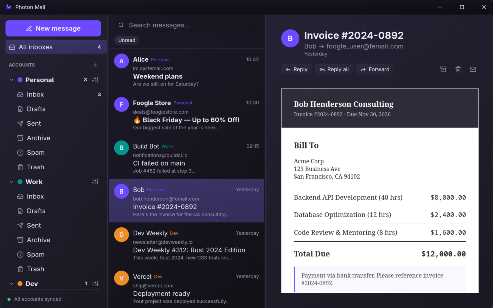
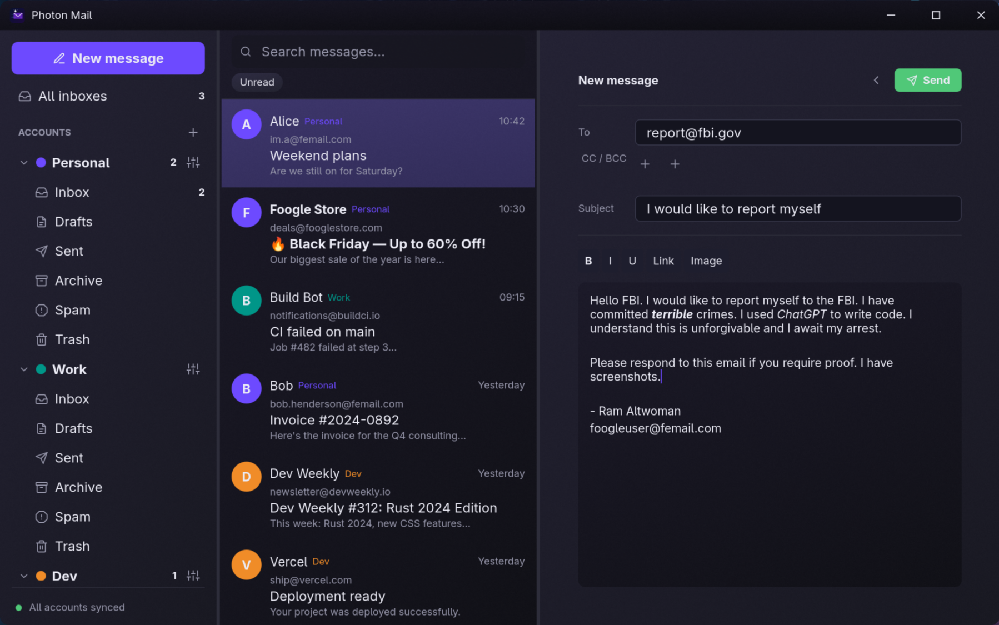

# Photon Mail

Browse and send email at light speed with Photon Mail. A fast, native desktop 
email client built with pure Rust.

## Features

- **Amazing lightweight UI** - polished dark theme with resizable panes, keyboard navigation, search, and unread filtering
- **View and send email with your IMAP account** - real-time sync with IDLE, secure HTML rendering, rich compose editor, auto-discovery for popular providers, and password storage in the OS keyring
- **Multiple accounts** - manage several email accounts in one window with a unified inbox view
- **More coming soon** - Photon Mail is early in development and is getting new features frequently. Stay tuned!

## Screenshots

**Main View**


**Email Composer**


## Building

### Build Requirements

- Rust 1.85 or later
- A C compiler (for Skia/freya build dependencies)
- On Linux: `dbus` package (for keyring password storage via Secret Service)

```bash
git clone https://github.com/Zytronium/PhotonMail.git
cd PhotonMail
cargo run --release
```

## Configuration

Account settings are stored in `<config dir>/PhotonMail/accounts.json`. Passwords are stored in the OS keyring under the `PhotonMail` service and are never persisted in plain text.

## Architecture

Photon Mail uses a two-thread architecture: the UI runs on Freya's main thread, while all IMAP I/O runs on a dedicated Tokio runtime. The UI communicates with the backend through an `async-channel` command/event pipeline, one worker per account.

```text
  UI thread (Freya)                       "photon-mail-io" thread (tokio)
  --------------------------------        --------------------------------
  AppState -- Command ----------------->  manager --> Worker (1 per account)
     ^                                                   |  sync, bodies, flags, moves
     +---------------- Event (async_channel) <--         |
                                                         + idle task: IMAP IDLE on INBOX
```

## Security

HTML emails are sanitized before rendering:

- `<script>` tags and `on*` event attributes are removed
- `javascript:` URLs are blocked
- Tracking pixels (1x1 images, invisible iframes, known tracking URLs) are stripped
- External link clicks show a confirmation dialog with a "do not show again" option per sender

## License

MIT License. Copyright © 2026 Zytronium. See [LICENSE](LICENSE) for details.
